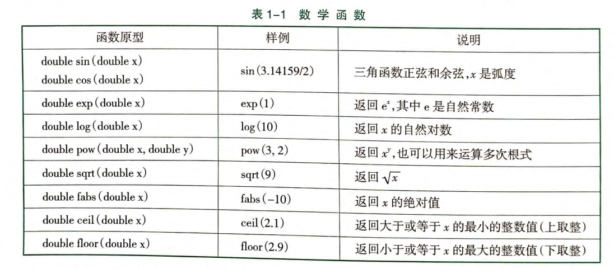
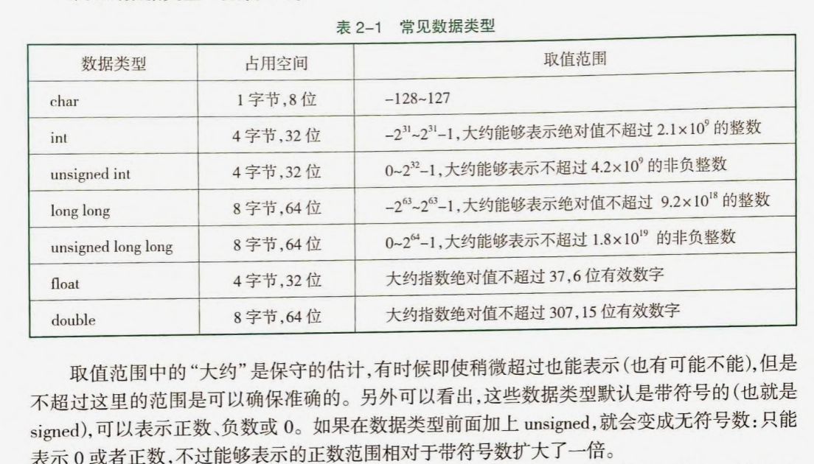
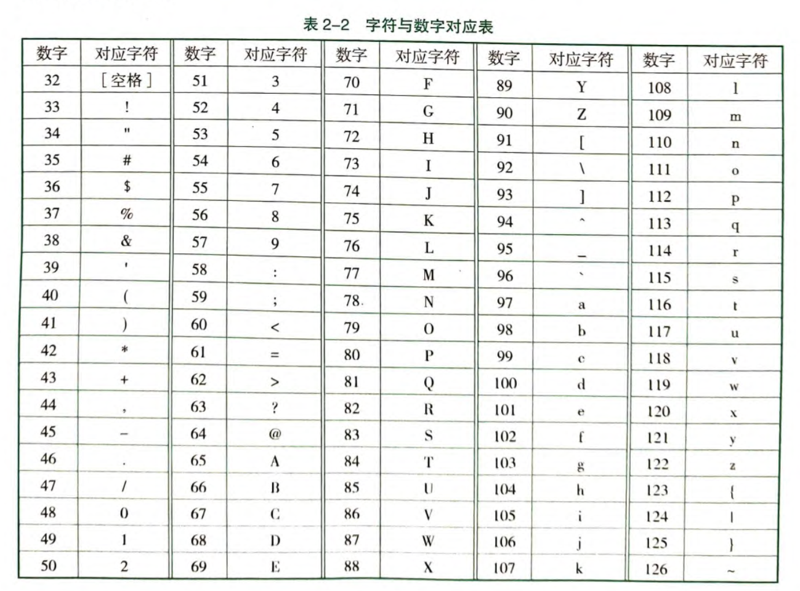
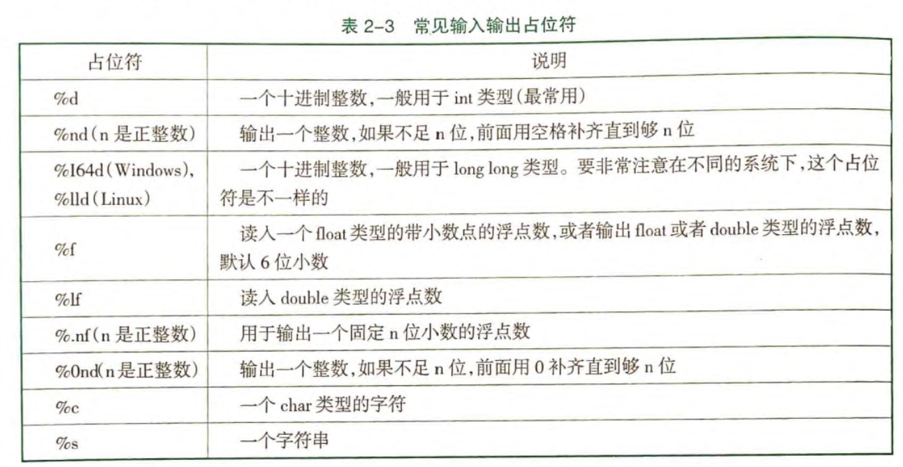

# 笔记

## 刷题网站

- 洛谷：
    - 技巧和竞赛
    - 真实应用场景
    - 生活化，需要构造数据结构
- leetcode：
    - 工程和生产环境
    - 算法
    - 结构化，不用构造数据结构

## 技巧

**输入输出加速**

```cpp
ios::sync_with_stdio(false),cin.tie(0),cout.tie(0);
```

**创建辅助**

- 辅助指针
    - prev指针可以不用额外创建，直接使用now，只是now指向prev而不是now
- 数组边界

## 注意事项

**数据范围**

是否需要开long long

**存储的内容**

值 or 索引

## 其他

### cmath 头文件：

### 数据范围

### ASCII 码表：

### 数的问题

计算注意整数相除的舍去问题
例如：pow(2,**1.0**/2)

四舍五入：int(x+0.5)

输入类型是 int a，但是要求 long long
不能 long long ans = a*a*a\*a
a 必须也是 long long

计算有进位的差值的时候，可以先转换为最小单位，然后用 mod 和/运算

浮点数不能直接用==判断

对浮点数可以先处理为 int

### 输入输出占位符

ios::sync_with_stdio(false),cin.tie(0),cout.tie(0)

1. 关闭同步的方式，但不能使用 scanf、print 的语句
2. 不能使用 getchar()方法
3. 不能 cout<<endl; ， 用 cout<<"\n";

直接输出条件的，如果没有括号，会编译错误

scanf 可以处理符号输入
scanf("%c-%c%c%c-")

除了 11 外，所有的偶数的回文数都是 11 的倍数

memset(arr,0,sizeof(arr))包好头文件<cstring></cstring>，只能初始化为 0、-1、0x3f
将 int 转化为一个字节的二进制，然后赋值给每个字节，初始化为无穷大

二维前缀和，左上角和右下角两个坐标+1 都++，左下和右上+1 都--

getchar() 返回读入的一个字符
putchar(s) 将字符输出
while(cin>>c) 可以使用 Ctrl+Z(Windows)结束，Ctrl+D(Linux)结束
getline(cin,str) 读入一行字符串，包含空格

文件输入输出 cstdio
freopen("title.in","r",stdin)
freopen("title.out","w",stdout)
